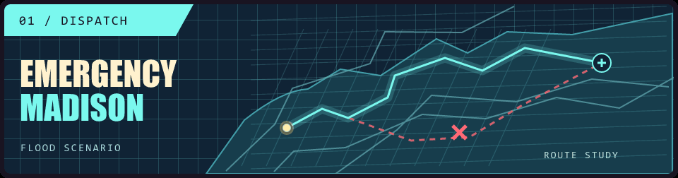
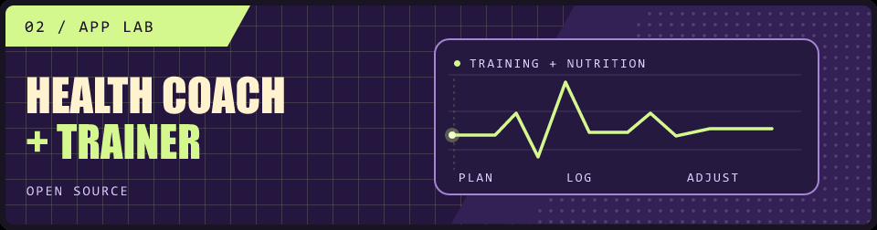

**[Big systems](#i-build-big-systems) · [Cool apps](#cool-apps-i-made) · [Fast carsss](#i-like-fast-carsss-i-code-fast-carsss) · [LinkedIn ↗](https://www.linkedin.com/in/arymaheshwari/)**

## I build big systems

**emergencyMadison · C3 AI Accelerator Hackathon winner**

What happens when John Nolen Drive floods right after a Badgers game? We built a 3D digital twin of Madison that reroutes ambulances around closures and congestion, then lets you ride along to the hospital.

<b>See what changes in flood mode</b>

The simulator closes affected road segments, adds game-day congestion, and recalculates both legs of the trip: station to incident, then incident to hospital. It compares those results with normal traffic across 2,436 modeled intersections.

**[Explore the implementation ↗](https://github.com/arymaheshwari/emergencyMadison/tree/workspace/7be4fcdc-0f45-4258-aa15-a5c62266cd65)**

## Cool apps I made

**Your AI Health Coach & Trainer · Open source**

An app that builds running and lifting plans around your goals and current fitness, suggests meals from what’s in your pantry, and keeps your workout and nutrition history in one place.

<b>Open the coach’s playbook</b>

Set a weekly schedule, fitness goals, and recent running times to get a training plan and daily calorie and macro targets. Follow workouts with a built-in timer, then log meals by scanning a barcode, snapping a nutrition label, or photographing your plate.

**[Browse the source ↗](https://github.com/arymaheshwari/Trainy)**

**First Up · Interactive Classroom Game**

I built a live quiz game for classrooms. The host runs it on the projector while students join from their phones to answer questions, make numeric guesses, or drop pins on an image. Scores and answer distributions update live.

<b>See a Pin It round</b>

**[Explore First Up ↗](https://github.com/arymaheshwari/First-Up-Interactive-Classroom-App)**

## I like fast carsss. I code fast carsss.

At **Wisconsin Racing**, I write C firmware for the Formula SAE steering wheel and build tools to collect aerodynamic data on the car.

**FSAE Michigan 2026 · 1st Design · 1st Acceleration · 3rd Autocross · 6th Overall**

<b>Open the pit notes</b>

The steering-wheel firmware reads driver inputs on an ESP32 and communicates over CAN. For aero testing, I built a calibration setup that sweeps a five-hole probe through pitch and yaw and logs differential pressure for each angle.

**[Inspect the calibration rig ↗](https://github.com/arymaheshwari/pitot_tube_code) · [Read UW’s race recap ↗](https://engineering.wisc.edu/blog/wisconsin-racing-2026-competition/)**

---

A lot of what I build is for internships or lives in private repos. I share more of that work on **[LinkedIn ↗](https://www.linkedin.com/in/arymaheshwari/)**. You can also **[explore my interactive portfolio ↗](https://arymaheshwari.com/)**.
